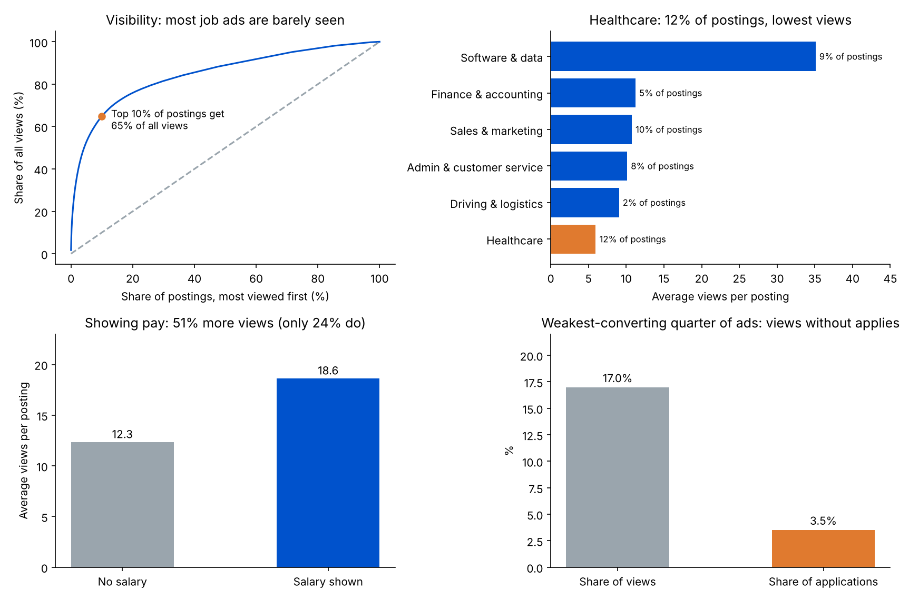

# Job Ad Performance Analytics: Visibility, Apply Rates and Where to Spend

What turns a job posting into applications? This project measures how views are spread across job ads, which ads convert views into applies, and which levers (showing pay, job family, ad triage) a recruitment-advertising team could use to get employers more applicants for the same budget.

**Data:** a **5,000-posting** random sample (seed 42) of the *LinkedIn Job Postings 2023–2024* dataset (arshkon, Kaggle, CC BY-SA 4.0; 123,849 postings in full), covering postings listed **26 Jan to 20 Apr 2024**. Each posting has its title, company, location, salary range (if shown), views and applies.



## Key findings

| Area | Finding | Lever |
|---|---|---|
| Data checks | Applies are **not recorded for 81%** of postings (they apply on another site), so conversion can only be measured on the rest. **31** probable duplicate postings and **64** missing company names were found. No impossible values (applies above views, expiry before posting, salary min above max). | Track applies across every channel; deduplicate before reporting |
| Visibility | The median posting got **4 views**, and **53%** got fewer than 5. The top **10%** of postings took **65%** of all views; the bottom half took **11%**. | Most ads need wider distribution, not a better ad |
| Apply rate | For the 783 postings with recorded applies and 10+ views, the median apply rate (applies ÷ views) is **13.5%**. The best quarter converts at **22%+** and the weakest at **8%** or less, a **2.8x** gap. | Optimise ads and spend on conversion, not just reach |
| Wasted reach | The weakest-converting quarter of ads took **17%** of views but produced only **3.5%** of applications. | Shift budget away from views that do not convert |
| Showing pay | Only **24%** of postings show a salary. They average **51% more views** (18.6 vs 12.3, Mann–Whitney p < 0.001) and convert slightly better (median **14.3%** vs **13.1%**, p = 0.045). | Advise employers to show pay ranges |
| Job families | Healthcare is **12%** of postings but averages **6 views**, against **35** for software and data roles (**5.9x**). | Hard-to-fill families need targeted channels and more budget |

## Method

**Apply rate** = applies ÷ views, measured only on postings with recorded applies and at least 10 views (so one view cannot make a 100% rate). The median is used because a few postings have very high counts.

**Visibility concentration.** Postings are sorted by views, most viewed first; top-10% share = views of the top 10% ÷ all views.

**Segments.** *Salary shown* = a minimum or maximum salary is present. *Remote, senior and entry-level* are flagged from words in the title and location. *Job families* are assigned from title keywords (see `FAM` in `run_analysis.py`); titles that match none are "Other". Differences are tested with a two-sided Mann–Whitney U test.

**Wasted reach.** Weakest-converting quarter = postings with an apply rate below the 25th percentile. View share = their views ÷ views of all measured postings; application share = their applies ÷ all applies.

**Showing-pay lever.** If postings without a salary averaged the views of postings with one: extra views = (average views with salary − average views without) × postings without salary.

## Outputs

- `results/job_ad_dashboard.xlsx`: Data checks, Segments, Job families and Apply rate sheets
- `results/results.json`: every number in this README
- `results/postings_tagged.csv`: each posting with its family and segment flags
- `results/summary.png`: the four charts above

## Limitations

- A 5,000-posting sample from one platform over about three months; the full dataset would give tighter estimates.
- Applies are only recorded for postings that take applications on LinkedIn, so apply rates describe that 19%.
- Showing pay and job family are associations, not proven causes: postings that show pay may differ in other ways. A controlled A/B test (the same job with and without pay) would prove the effect.
- There is no spend data, so the analysis uses views and applies rather than cost per application.
- Job families come from title keywords, so a few titles may be misclassified. Small families (for example 27 healthcare postings with measurable apply rates) give rough apply-rate estimates.

## Run it

```bash
pip install pandas numpy scipy matplotlib openpyxl
python get_data.py       # only if data/ is empty: downloads the sample into data/
python run_analysis.py   # writes results/results.json, job_ad_dashboard.xlsx, postings_tagged.csv
python make_charts.py    # writes results/summary.png
```

## Data source

arshkon, *LinkedIn Job Postings (2023–2024)*, Kaggle, CC BY-SA 4.0. The 5,000-posting random sample used here is published in a public GitHub repository (`claretondori/qa_data_suite`); `get_data.py` downloads it.
